<p align="center">
  
</p>

> Générateur de sites d'affiliation statiques : un modèle, une commande par site.

  

**Statut** — 🟠 En cours

---

# Affiliation

Sites d'affiliation statiques, construits avec la méthode du guide « Comment générer ses premiers euros en affiliation ». Le contexte complet (structure, règles, avancement) est dans [`CLAUDE.md`](CLAUDE.md).

## Installation (Windows, une seule fois)

1. Installer [Node.js](https://nodejs.org) en version LTS.
2. Dans le dossier du projet : `npm install`

## Au quotidien

```
npm run nouveau-site -- seche-cheveux   # créer un site à partir du modèle
npm run dev -- seche-cheveux            # voir le site sur http://localhost:8080
npm run garde-fou -- seche-cheveux      # contrôler avant de publier
```

## Mettre en ligne (module 7)

N'importe quel hébergeur de sites statiques convient. Réglages à lui donner :

- Commande de construction : `npm run publier -- <site>`
- Dossier à publier : `dist/<site>`

La commande échoue si le garde-fou trouve une erreur : un site qui n'est pas propre ne peut pas partir en ligne.

Après publication : `npm run indexnow -- <site> --envoyer` pour prévenir Bing (module 9).
